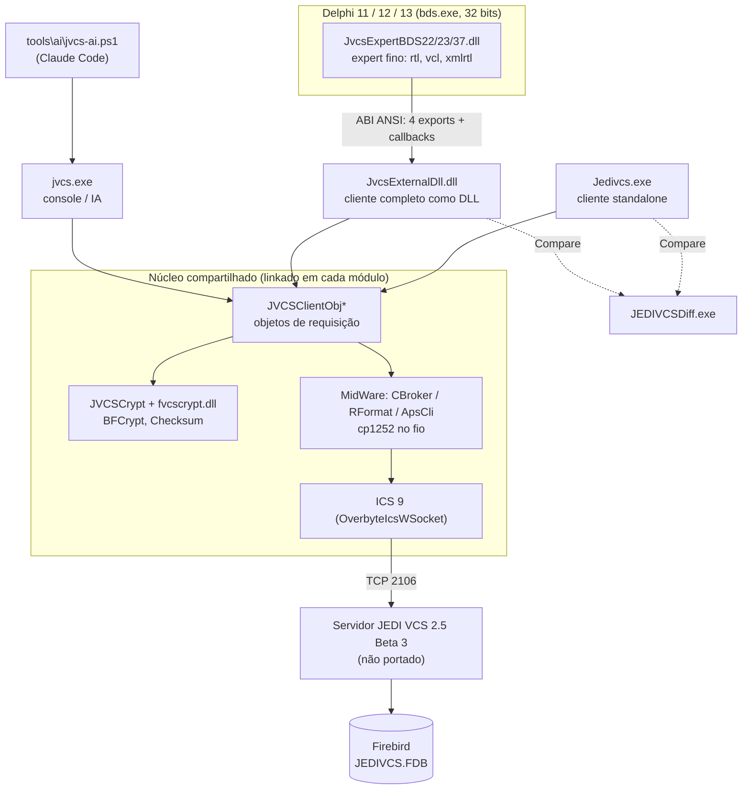
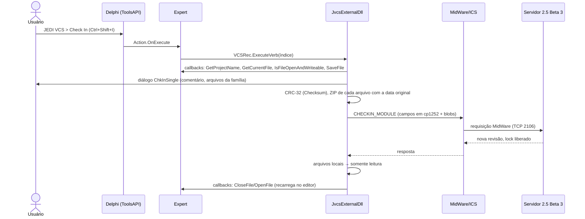

# Arquitetura

Como as peças do JEDI VCS 2.5 Beta 2026 se ligam, o caminho de um check-in até o servidor e o contrato
binário entre o expert e a DLL. Mapa de pastas: [README](README.md). Decisões por trás disso:
[03 Decisões](../processo/03-Decisoes-de-Arquitetura.md).

## 1. Visão geral

- **Núcleo único:** EXE, DLL e console compilam as **mesmas units** (`src\jedivcs`, `src\common`,
  `src\common\client`) com defines diferentes (`IDEDLL;EXT_IDE_INTF` na DLL, `JVCSCONSOLECLIENT` no
  console). Não há pacote compartilhado em tempo de execução.
- **Expert fino:** só traduz a ToolsAPI em chamadas da ABI; toda a interface e o protocolo estão na DLL.
- **Servidor intocado:** o 2.5 Beta 3 aceita o cliente novo porque os bytes no fio são os mesmos
  ([04 Testes](../processo/04-Testes-e-Validacao.md)).

## 2. Fluxo de um check-in

Exemplo: check-in de `uPrincipal.pas` (+ `.dfm` pela família) a partir da IDE.

Passos internos no cliente (mesmos no EXE e no console):

1. **Sessão:** `LOGIN` com a identidade salva (`HKCU\Software\JEDI\JEDIVCS`); a senha é cifrada pela
   `fvcscrypt.dll` (`JVCSCrypt`); a versão enviada vem do VERSIONINFO (250).
2. **Estado do módulo:** `GET_LOCKED_MODULES`/informação do projeto; o check-in exige lock do usuário.
3. **Conteúdo:** para cada membro da família, `CRCInt` e um blob **ZIP de 1 item** (nome sem caminho,
   data do arquivo) — compatível com o que o original grava e lê.
4. **Requisição:** `TJVCSClientObj` monta os campos; `RFormat` (`TMWBuffer`) serializa com
   `MWCodePage = 1252`; `ApsCli` (`TAppSrvClient`) envia pelo socket do ICS.
5. **Resposta:** nova versão (ex.: 0.8 → 0.9); o cliente marca os arquivos como somente leitura e
   atualiza a lista.

## 3. ABI expert ↔ DLL

Contrato herdado do 2.5.0.1030 e mantido **sem alteração**, para que o expert novo carregue tanto a DLL
nova quanto a original. Tipos em `src\common\JVCSIDEInterfaceCommon.pas` (lado DLL) e
`src\jvcsideexpert\JVCSExpertABI.pas` (cópia no expert, conferida por `JvcsAbiCrossCheck`):
`stdcall`, `PAnsiChar` em todas as strings, enums com `{$Z1}`.

### 3.1 Os 4 exports da DLL

| Export | Chamado | Faz |
|---|---|---|
| `JEDIVCSDLLINIT(@IDERec, @VCSRec, @NotifierRec)` | ao criar o wizard | recebe as **24 callbacks** do expert (`IDERec`) e preenche `VCSRec` (10 funções) e `NotifierRec` (2); inicializa opções, data module e auto-login |
| `JEDIVCSDLLHISTORYINIT(@HistoryRec)` | logo depois | preenche as 9 funções de History (aba History do editor via `IOTAFileHistoryProvider`) |
| `JEDIVCSDLLOPERATIONINIT(@OperationRec)` | depois do menu | preenche as 10 operações do menu de contexto do Project Manager |
| `JEDIVCSDLLFINALIZE` | ao descarregar o wizard, **antes** do `FreeLibrary` | libera forms e conexão |

O expert localiza a DLL **na própria pasta** e usa `GetProcAddress` por nome (os ordinais mudaram e não
importam).

### 3.2 Callbacks e funções

| Record | Direção | Conteúdo |
|---|---|---|
| `TExternalIDEFunctionRec` (24) | DLL → expert → IDE | `CloseProject`, `CloseFile`, `SaveFile`, `OpenFile`, `GetParentHandle`, `GetProjectName` (o `.dpr`/`.dpk`), `GetUnitCount`/`GetUnitName`, `GetFormCount`/`GetFormName`, `GetCurrentFile`, `IsFileOpen`, `GetModuleCount`/`GetModuleName`, `GetComponentCount`/`GetComponentName`, `RaiseException` (mostra mensagem), `GetBaseRegistryKey`, `GetModuleComponentCount`/`GetModuleComponent`, `SourceWriteString`/`SourceReadString`, `GetOptions`, `IsFileOpenAndWriteable` |
| `TExternalVCSFunctionRec` (10) | expert → DLL | `ExecuteVerb`, `GetMenuName`, `GetVerb`, `GetVerbCount` (27 na nova), `GetVerbState`, `GetVerbImages`, `GetVerbImageIndex`, `GetVerbShortCut`, `ProjectChange`, `GetIDString` |
| `NotifierRec` (2) | expert → DLL | `FileNotification`, `EventNotification` (abrir/fechar arquivo, antes/depois de compilar) |
| `HistoryRec` (9) | expert → DLL | revisões, comentários e conteúdo para a aba History |
| `OperationRec` (10) | expert → DLL | operações do menu do Project Manager |

Regras da ABI:

- Strings sempre `PAnsiChar` na code page ANSI do Windows, **sem "best fit"** (`JVCSDLLAnsi`).
- Buffers de saída do expert: no máximo 255 caracteres + `#0`; a DLL zera e termina os de 1 KB.
- Nada gerenciado (string Delphi, objeto, interface) atravessa a fronteira; sem `ShareMem`.
- Informação nova que não cabe na ABI vai por **variável de ambiente do processo** antes do
  `JEDIVCSDLLINIT` (ex.: `JVCS_IDE_THEME`), mantendo a compatibilidade com a DLL original.

Detalhe e disassembly do original: [Expert-IDE-Analise §3](../client/Expert-IDE-Analise.md);
port: [Port-DLL-IDE](../client/Port-DLL-IDE.md).

## 4. Aparência

| Peça | Papel |
|---|---|
| `JVCSUIScale` | fonte, tamanho e escala (100–200%) da interface, menus e editores |
| `JVCSUITheme` | tema: seguir host / claro / escuro; VCL Style "Windows Modern Dark" embutido; Windows via `AppsUseLightTheme`; IDE via `JVCS_IDE_THEME` ou registro |
| `JVCSForms` (`TJVCSForm`) | aplica escala/tema a cada form e garante o tamanho mínimo |
| `JVCSClientAppearance` | inicialização e reaplicação no EXE e na DLL |

Na DLL o tema fica **contido** nas janelas do JEDI VCS (sem pintar a IDE). Preferências em
`HKCU\Software\JEDI\JEDIVCS\Options`.

## 5. Arquivos de configuração e logs

| O quê | Onde |
|---|---|
| Identidades, opções, posições de janela | `HKCU\Software\JEDI\JEDIVCS` (compartilhado com o cliente original) |
| Config da IA (`[ai] checkout=`, `checkin=`, `jvcsExe=`) | `%APPDATA%\JEDI\JVCS\config.ini` (`JVCSAIConfig`) |
| Log de erros do EXE/DLL/expert | `%LOCALAPPDATA%\JEDI\JVCS\logs\` (`jvcs-exe-*`, `jvcs-dll-*`, `jvcs-expert-AAAAMMDD.log`) |
| Registro do expert | `HKCU\Software\Embarcadero\BDS\<v>\Experts` (v = 22.0, 23.0 ou 37.0), valor `JVCSIDEClient` |
