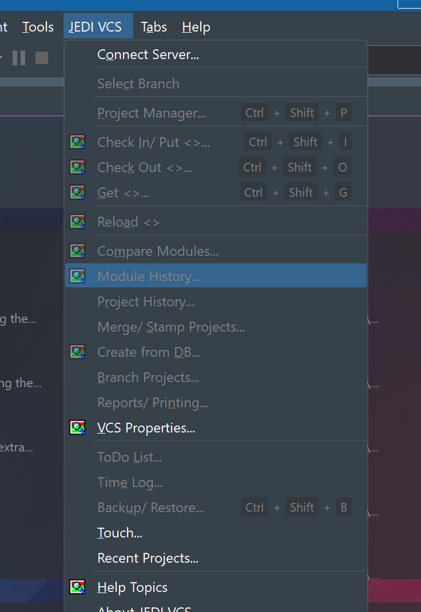

# 03. Integração com o Delphi

Como instalar, verificar e remover o expert **JEDI VCS 2.5 Beta 2026** no **Delphi 13.2 Florence** (BDS 37.0, IDE de **32 bits**). Detalhes técnicos: [src\jvcsideexpert\LEIAME.md](../../src/jvcsideexpert/LEIAME.md).

> **Regra de ouro: feche o Delphi (`bds.exe`) antes de mexer no registro.** A IDE regrava o registro e o `EnvOptions.proj` ao fechar e **desfaz** qualquer mudança feita com ela aberta. Foi exatamente isso que fez o expert não carregar na primeira tentativa: as mudanças de registro não chegaram à IDE. Confira no Gerenciador de Tarefas que não há `bds.exe` rodando.

## 1. O que é o expert

`JvcsExpertBDS37.dll` é um expert (wizard) da IDE que carrega a **`JvcsExternalDll.dll` original** do JEDI VCS 2.5.0.1030 (Delphi 2007, ANSI). Com isso o cliente completo (menu JEDI VCS, Project Manager, histórico, Diff) funciona dentro do Delphi 13 falando com o servidor 2.5 Beta 3, antes de o cliente ser portado.

## 2. Pré-requisitos

| Item | Detalhe |
|---|---|
| Delphi 13.2 Florence | Instalado em `C:\Program Files (x86)\Embarcadero\Studio\37.0`. O expert só carrega na **IDE de 32 bits**: `bin\bds.exe`. A `bin64\bds.exe` não carrega DLL de 32 bits |
| Servidor e usuário | Servidor no ar ([capítulo 01](01-Servidor-Instalacao-e-Configuracao.md)) e um usuário ([capítulo 02](02-Cliente-Primeiro-Acesso.md)) |
| Pasta do expert | `D:\Delphi\JediVCS\v2026\bin\ideclient\Win32` (seção 3) |
| Delphi fechado | Para qualquer alteração de registro |
| Esta máquina | Windows 11 ARM64 (VM); o Delphi roda por emulação x64, o que a Embarcadero não suporta oficialmente |

> **Atenção (instalação do Delphi 13):** se o componente **AndroidSDK** falhar com `Java JDK not found`, instale o **JDK 21 (Temurin)** e repita a instalação do recurso em **Tools > Manage Features**. Isso não é necessário para o expert, só para o Delphi.

## 3. A pasta `bin\ideclient\Win32`

Conteúdo (tudo precisa ficar **junto**, a DLL procura tudo na própria pasta):

| Arquivo | Papel |
|---|---|
| `JvcsExpertBDS37.dll` (+ `.map`, `.drc`) | O expert |
| `JvcsExternalDll.dll` | O cliente JEDI VCS 2.5.0.1030 original (só é copiada se o SHA-256 for o da 2.5.0.1030) |
| `fvcscrypt.dll`, `zipdll.dll`, `unzdll.dll` | Criptografia de senha e compactação (32 bits) |
| `htm_rep.htm`, `ffdef.jvcs`, `ulist.jvcs`, `vcllist.jvcs`, `vcllistbcb.jvcs`, `verinf.jvcs` | Dados do cliente |
| `jedivcs.chm`, `jedivcsdiff.chm`, `jedivcsdiff.exe` | Ajuda e o Diff usado em Compare |

Para recompilar (Delphi **fechado**): `D:\Delphi\JediVCS\v2026\tools\compilar-expert.bat` (código de saída 0 = OK). Um build com falha não apaga o expert que a IDE já usa.

> **Atenção:** não coloque as DLLs do cliente em pasta de rede. Elas precisam estar em disco **local** (ajuda, "Network installation").

## 4. Registrar o expert

O expert é registrado pelo valor `JVCSIDEClient` em `HKCU\Software\Embarcadero\BDS\37.0\Experts`, que é o mesmo nome que o instalador do JEDI VCS usa. Escolha **um** método, sempre com o Delphi fechado.

### Método recomendado: o instalador

`setup\Output\JediVCS-2.5-Beta2026-Setup.exe` instala o expert com a DLL nova e o runtime numa pasta só
(`C:\Program Files (x86)\JEDI\JVCS 2026`), registra o `JVCSIDEClient` nas IDEs detectadas e devolve o valor
anterior ao desinstalar. Passo a passo no [capítulo 09](09-Instalador-do-Cliente.md). Os métodos abaixo
continuam valendo para desenvolvimento (pasta `bin\ideclient\Win32`).

### Método A: importar o `.reg` (só esta máquina)

```
reg import "D:\Delphi\JediVCS\v2026\setup\Delphi13-JVCS-v2026.reg"
```

(ou duplo clique no arquivo.) Ele aplica de uma vez: SynEdit e Virtual Treeview da v2026 em `Known Packages` (e remove os do GetIt), Library Path, PATH da IDE e o expert `JVCSIDEClient`.

> **Só no ambiente de teste:** esse `.reg` tem caminhos fixos desta máquina (`D:\Delphi\JediVCS\v2026\...`, `C:\Users\edmarfrazao\...`) e mexe em bibliotecas de desenvolvimento do port. **Não importe nas máquinas dos colegas.**

### Método B: só o expert (colegas e produção)

1. Copie a pasta `bin\ideclient\Win32` inteira para um disco local, por exemplo `C:\JEDIVCS\ideclient\Win32` (nome de exemplo).
2. Feche o Delphi e rode:

```
reg add "HKCU\Software\Embarcadero\BDS\37.0\Experts" /v JVCSIDEClient /t REG_SZ /d "C:\JEDIVCS\ideclient\Win32\JvcsExpertBDS37.dll" /f
```

3. Não registre em `Experts x64` (a `JvcsExternalDll.dll` é de 32 bits).

### Método C: teste isolado (opcional)

`bds.exe -rJVCSTeste` usa o registro `HKCU\Software\Embarcadero\JVCSTeste\37.0`. Registre o expert em `...\JVCSTeste\37.0\Experts` e o perfil principal do Delphi não é tocado.

## 5. Verificar se carregou

Abra `C:\Program Files (x86)\Embarcadero\Studio\37.0\bin\bds.exe` (32 bits).

1. **Splash:** aparece "JEDI Version Control System 2.5 Beta 2026" (imagem: [expert-bds37-splash.webp](../client/img/expert-bds37-splash.webp)).
2. **Help > About:** o plugin do JEDI VCS aparece, com a licença MPL 1.1.
3. **Menu JEDI VCS** logo depois de Tools, com a legenda e cerca de 27 itens com ícones:



| Item do menu | Atalho |
|---|---|
| Connect Server... | |
| Project Manager... | Ctrl+Shift+P |
| Check In/ Put... | Ctrl+Shift+I |
| Check Out... | Ctrl+Shift+O |
| Get... | Ctrl+Shift+G |
| Backup/ Restore... | Ctrl+Shift+B |
| Reload, Compare Modules..., Module History..., Project History..., Merge/ Stamp Projects..., Create from DB..., Branch Projects..., Reports/ Printing..., VCS Properties..., ToDo List..., Time Log..., Touch..., Recent Projects..., Help Topics, About JEDI VCS | |

   Sem conexão e sem projeto, a maioria fica **desabilitada** (cinza). Isso é normal.
4. **Tools > Options > Keyboard** (ou Customize): as ações aparecem na categoria "JEDI VCS".
5. Se o menu mostrar **"JvcsExternalDll.dll not loaded - details…"**, o expert carregou mas a DLL do cliente não: clique no item e veja os caminhos tentados. Causa comum: a `JvcsExternalDll.dll` não está na mesma pasta do expert.
6. Se **nada** aparece (nem splash nem menu): o valor `JVCSIDEClient` não está no registro, aponta para um caminho errado, ou você abriu a IDE de 64 bits. Veja o [capítulo 08](08-Solucao-de-Problemas.md).

Estado do port: o expert foi **carregado** na IDE de 32 bits em 12/10/2026 (splash e menu confirmados). Os testes funcionais (Connect Server, Project Manager, check-in/out, History, menu do Project Manager) ainda estão pendentes ([Status.md](../common/Status.md)).

## 6. Primeiro uso na IDE

1. **JEDI VCS > Connect Server...** e escolha a identidade (capítulo 02). Na primeira vez aparece o aviso do programa.
2. Abra um projeto salvo com **nome válido** (capítulo 02, seção 8.2).
3. **JEDI VCS > Project Manager...** (Ctrl+Shift+P). Para o projeto novo, aceite criar o projeto e adicionar os módulos principais; depois faça o check-in de todos.
4. No dia a dia: Check Out/Check In pelo menu, pelos atalhos ou pelo botão direito do arquivo no **Project Manager da IDE** (JEDI VCS > Check In, Check Out, Get, Reload, Compare, Diff, History); a aba **History** de uma unit mostra as revisões do JEDI VCS.
5. **Auto connect server when starting the IDE** (VCS Properties > Common Options): o expert adia a conexão até a janela principal ficar visível, para o diálogo não aparecer sobre o splash.

## 7. Variáveis de ambiente do expert

Lidas quando o expert carrega. Defina **antes** de abrir a IDE e reinicie a IDE para valer.

| Variável | Valores | Efeito |
|---|---|---|
| `JVCS_EXPERT_LOG` | caminho de um arquivo, por exemplo `C:\temp\jvcs-expert.log` | Grava o log do expert (UTF-8): carga da DLL, verbos, notificações, erros. Sem ela, só sai por `OutputDebugString` (DebugView, prefixo `[JVCS Expert]`) |
| `JVCS_EXPERT_DPI` | `off`, `unaware`, `gdiscaled` (padrão) | Contexto de DPI das janelas da DLL. `gdiscaled` amplia pelo Windows; `off` desliga como o expert original |
| `JVCS_EXPERT_DEFERINIT` | `auto` (padrão), `on`, `off` | Adia a inicialização da DLL até a IDE ficar visível. `auto` adia só com "Auto connect" ligado |

Definir de forma permanente para o seu usuário (crie antes a pasta `C:\temp`):

```
setx JVCS_EXPERT_LOG C:\temp\jvcs-expert.log
```

Só para uma sessão: no prompt `set JVCS_EXPERT_LOG=C:\temp\jvcs-expert.log` e abra a IDE **pelo mesmo prompt** (`"C:\Program Files (x86)\Embarcadero\Studio\37.0\bin\bds.exe"`). Para remover a variável permanente: `reg delete HKCU\Environment /v JVCS_EXPERT_LOG /f`.

No log, o ciclo normal tem `INIT`, `HISTORYINIT`, `OPERATIONINIT` ao abrir e `FinalizeWizard`, `JVCS Expert finalizando` e `JvcsExternalDll descarregada` ao fechar.

## 8. Desinstalar ou reverter

Sempre com o Delphi **fechado**.

### 8.1 Só o expert

```
reg delete "HKCU\Software\Embarcadero\BDS\37.0\Experts" /v JVCSIDEClient /f
```

(Importar o `Experts_antes_jvcs.reg` não adianta: o `.reg` só acrescenta, não apaga o valor.) A configuração do cliente em `HKCU\Software\JEDI\JEDIVCS` (identidades, opções) **não** é apagada e é compartilhada com o cliente oficial instalado; só remova se quiser esquecer as identidades.

### 8.2 Tudo que o `.reg` mexeu (SynEdit, Virtual Treeview, Library Path, PATH)

Os backups estão em `C:\Users\Public\Documents\Embarcadero\Studio\37.0\_backup_getit_20261012`:

| Item | Conteúdo |
|---|---|
| `BDS37_antes_instalacao.reg` | Exportação do registro da IDE antes das mudanças |
| `EnvOptions_antes_instalacao.proj` | Cópia do `%APPDATA%\Embarcadero\BDS\37.0\EnvOptions.proj` antes das mudanças |
| `Experts_antes_jvcs.reg` | A chave `Experts` antes de gravar o `JVCSIDEClient` |
| `Bpl\`, `Dcp\` | BPL/DCP do GetIt (SynEdit e Virtual Treeview) |

O passo a passo completo está em [Ambiente.md](../common/Ambiente.md), seção 5.2. Resumo e cuidados:
1. `reg import` do backup só **acrescenta/sobrescreve**; os valores criados depois (os dois BPL novos em `Known Packages`, os caminhos `D:\Delphi\JediVCS\v2026\...` do Library Path e o primeiro item do PATH da IDE) precisam ser removidos à mão.
2. Copie o `EnvOptions_antes_instalacao.proj` sobre o arquivo atual.
3. Alternativa mais limpa para SynEdit/Virtual Treeview: reinstalar pelo GetIt.

## 9. Limitações

| Limitação | Efeito e contorno |
|---|---|
| **Só IDE de 32 bits** | O `bin64\bds.exe` não carrega o expert. Isso só muda depois do port da DLL para Win64 |
| **DLL antiga (Delphi 2007, ANSI)** | Nomes de arquivo e textos fora da página de código do Windows (CP 1252) viram `?` e a operação nesse arquivo falha. Use nomes em ASCII. O conteúdo do editor também passa por ANSI, então caracteres sem equivalente se perdem na expansão de keywords e na marcação de check-in |
| **Caminhos com mais de 255 bytes** | A DLL "não vê" o projeto ou a unit. Mantenha pastas curtas |
| **Duas VCLs no mesmo processo** | As janelas do JEDI VCS **não seguem o tema** nem os VCL Styles da IDE (IDE escura, janelas claras). Em formulários não modais, como o Project Manager, Tab, atalhos e dicas podem falhar |
| **DPI** | Com `gdiscaled` o tamanho fica certo, mas o texto fica levemente borrado em escalas altas. Se algo ficar estranho, teste `JVCS_EXPERT_DPI=off` |
| **Tamanho de fonte** | Ainda não há opção. Paliativos: Configurações > Acessibilidade > Tamanho do texto; ou Sistema > Tela > Escala 125%; para o `jedivcs.exe`, Propriedades > Compatibilidade > "Alterar configurações de DPI alto" > "Substituir comportamento" = **Sistema (Avançado)**. Planejado em [Requisito-Tamanho-Fonte.md](../client/Requisito-Tamanho-Fonte.md) |
| **Auto-login com grupo de projetos** | A reabertura automática cobre só o projeto **ativo** do grupo |
| **Erro aleatório (AV) dentro da DLL** | A `bds.exe` é LARGEADDRESSAWARE e a DLL antiga pode falhar com endereços acima de 2 GB. Registre o log e reporte |
| **Menu do Project Manager** | Sem ícones (a API nova não tem imagem); `.fmx` é tratado como o `.pas` correspondente |
| **Delphi 11 e 12** | Não instalados nesta máquina; builds `JvcsExpertBDS22/23.dll` não testados |
| **`DelphiLSP.exe`** | O LSP da IDE falha (AV em `dcc32370.dll`) com ou sem o expert. É problema da IDE, não do JEDI VCS ([capítulo 08](08-Solucao-de-Problemas.md)) |
