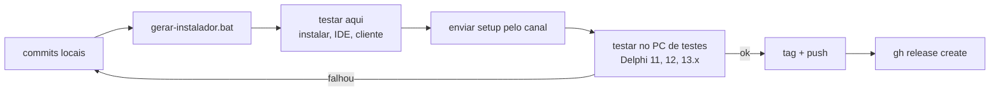

# 05. Processo de release

Como uma versão do JEDI VCS 2.5 Beta 2026 sai do repositório para a página de
[Releases](https://github.com/edmarfrazao/JEDI_VCS/releases). Regra de ouro: **só publica o que foi
instalado e testado no PC de desenvolvimento e no PC de testes**. Anterior: [04 Testes](04-Testes-e-Validacao.md). Próximo:
[06 Problemas conhecidos](06-Problemas-Conhecidos-e-Licoes.md).

## Fluxo



## 1. Gerar o instalador

Com o Delphi **fechado** (o expert carregado não é sobrescrito):

```
tools\gerar-instalador.bat              (compila Release Win32 de tudo e empacota)
tools\gerar-instalador.bat --sem-build  (só empacota o que já está em bin\)
```

O script, em ordem:

1. `tools\compilar.bat exe|dll|diff|console Release Win32` e `tools\compilar-expert.bat Release nova`
   (e o expert do Delphi 11/12, se instalados);
2. confere que `Jedivcs.exe`, `JEDIVCSDiff.exe`, `jvcs.exe`, `JvcsExternalDll.dll` e cada
   `JvcsExpertBDS<nn>.dll` existem e têm **FileVersion 2.5.0.&lt;Build&gt;** (Build de `tools\versao.ini`:
   suba-o antes de gerar a beta — regra em [Versoes.md](../common/Versoes.md#numeração-de-versões));
3. confere cada expert com `tools\verificar-expert.ps1` (só `rtl`/`vcl`/`xmlrtl`, 0 símbolos ausentes);
4. confere o runtime em `3rdparty` e roda o **ISCC** (Inno Setup 6).

Saída: `setup\Output\JediVCS-2.5.0-Beta5-build2050-Setup.exe` (fora do git). Log: `tools\logs\gerar-instalador.log`.
Avisos que não bloqueiam mas devem ser lidos: build Debug mais novo que o Release, `.map` ausente, DLL de
`bin\ideclient` diferente da de `bin\client`. Detalhes: [setup/LEIAME](../../../setup/LEIAME.md).

## 2. Testar aqui

| Passo | Esperado |
|---|---|
| Instalar (assistente) com o Delphi fechado | pasta `JEDI\JVCS 2026`; expert registrado nas IDEs detectadas |
| Abrir o Delphi 13 | splash "JEDI Version Control System 2.5.0 Beta N - build &lt;Build&gt;", menu **JEDI VCS** |
| Connect Server, Project Manager, check-in/checkout de um módulo de teste, History | sem erro; LOGIN aceito |
| `Jedivcs.exe` standalone e `jvcs.exe listprojects` | mesmos projetos |
| Tema claro/escuro e escala 150% | legível, sem cortes |
| Fechar o Delphi | sem AV; log em `%LOCALAPPDATA%\JEDI\JVCS\logs` sem erros novos |
| Reinstalar por cima e desinstalar | valor anterior de `JVCSIDEClient` restaurado |

## 3. Testar no PC de testes (canal)

1. Copiar o setup para `canal\arquivos\NNNN\` e enviar o pedido:
   `canal.ps1 enviar -Titulo "Testar setup beta N" -ArquivoTexto pedido.md` — o pedido lista o roteiro
   (instalar com o Delphi fechado; abrir Delphi 11, 12 e 13.x; conferir splash/menu/conexão; colher logs).
2. `canal.ps1 aguardar -Id NNNN -TimeoutMin 60` e ler a resposta com `canal.ps1 ler -Id NNNN`.
3. Falhou em alguma IDE → corrigir, novo commit, voltar ao passo 1 do fluxo.

## 4. Publicar

Só depois dos passos 2 e 3 verdes, e **com autorização explícita do mantenedor** para o push:

```
git tag -a v2.5.0.2026-betaN -m "JEDI VCS 2.5 Beta 2026 - beta N"
git push origin main --tags
gh release create v2.5.0.2026-betaN setup\Output\JediVCS-2.5.0-Beta5-build2050-Setup.exe ^
  --prerelease --title "JEDI VCS 2.5 Beta 2026 - beta N" --notes-file notas.md
```

Convenção de tags: `v2.5.0.2026-beta1` a `v2.5.0.2026-beta4` (as betas 1 a 4 tinham todas o FileVersion
`2.5.0.2026`). A partir da beta 5 cada beta tem o seu build (`2.5.0.2050`, `2.5.0.2060`, ...; ver
[Versoes.md](../common/Versoes.md#numeração-de-versões)) — a tag a usar (manter `v2.5.0.2026-betaN` ou passar a
`v2.5.0.<Build>-betaN`) é decisão do mantenedor. A release é marcada como **pre-release**.

## Checklist

- [ ] `git status` limpo; commits em português, pequenos.
- [ ] `tools\gerar-instalador.bat` com código 0 e sem avisos inesperados no log.
- [ ] Todos os experts conferidos pelo `verificar-expert.ps1` (13.x, 12.x, 11.x presentes no pacote).
- [ ] Instalado e testado aqui (tabela da seção 2).
- [ ] Testado no PC de testes pelo canal (Delphi 11, 12 e 13.x) e resposta arquivada.
- [ ] Notas da release: novidades, correções, problemas conhecidos, aviso do MidWare (uso não comercial).
- [ ] Nada sensível no pacote nem nas notas (senhas, IPs internos, caminhos pessoais).
- [ ] Tag criada, push autorizado, `gh release create --prerelease` com o setup anexado.
- [ ] CHANGELOG, novidades e esta documentação atualizados.
